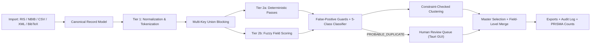

# 02 — Deduplication Rules & Pipeline Specification

This document contains the original proposed pipeline, not implemented behavior.
The [engine contract](10-engine-contract.md) is normative where details conflict.
Numeric scores below are unvalidated design candidates; B03/B07 must define one
versioned policy, evidence handling and decision precedence before implementation.

---

## 1. Tier 1: Pre-Processing Normalization & Tokenization

All original metadata fields are preserved untouched on `CanonicalRecord` for display and export. Normalization produces dedicated comparison keys (`NormalizedFields`):

### 1.1 Title Normalization & Bracketed Artifact Handling
1. **HTML & Entity Cleaning:**
   - Decode HTML/XML character entities (`&amp;` -> `&`, `&quot;` -> `"`, `&#8211;` -> `-`, etc.).
   - Strip inline formatting tags (`<i>`, `</i>`, `<b>`, ``, ``, `<scp>`, MathML tags) commonly embedded in environmental science, chemistry, and medical titles.
2. **Whole-Title Bracket Unwrapping (Translated Titles):**
   - Check if the trimmed title (ignoring trailing `.`) starts with `[` and ends with `]` with no closing `]` in the interior (e.g., `[Intervention effects on reading fluency in dyslexic children].`).
   - If true, **unwrap** the outer brackets and set `is_translated_title = true`.
3. **Whitelisted Artifact Stripping:**
   - Strip only explicit, known database/editorial artifact tags at the start or end of titles (case-insensitive):
     - `[Abstract]`, `(Abstract)`, `[Book Review]`, `(Book Review)`, `[Editorial]`, `[Erratum]`, `[Published Erratum]`, `[Corrigendum]`, `[Retraction]`, `[Letter]`, `[Comment]`, `[Reply]`, `[Translated Title]`, `[In Process Citation]`, `[Audio Podcast]`, `[Video]`.
   - **Important:** When stripping tags like `[Erratum]`, `[Retraction]`, `[Book Review]`, `[Comment]`, or `[Reply]`, set the corresponding boolean guard flag (`is_erratum_or_retraction`, `is_comment_or_reply`, `is_book_review`) on the record so False-Positive Guards (§4) can prevent erroneous merges!
4. **Character & Case Normalization:**
   - Apply Unicode NFKC normalization and decompose/strip combining diacritical marks (`é` -> `e`, `ü` -> `u`, `ł` -> `l`).
   - Map common Greek characters (`α` -> `alpha`, `β` -> `beta`, `γ` -> `gamma`, `δ` -> `delta`, `μ` -> `mu`).
   - Unify dashes/hyphens (`–`, `—`, `−`, `-`) to space when tokenizing words, and strip remaining non-alphanumeric punctuation.
   - Fold to ASCII lowercase and collapse whitespace.
   - Generate:
     - `title_norm_full`: full normalized string.
     - `title_norm_main` / `title_norm_subtitle`: split on the first `:` or ` - ` or `? ` to handle records where one database omits or adds a subtitle (e.g., `: A randomized controlled trial`).
     - `title_tokens`: set of non-stopword alphanumeric tokens (with optional US/UK spelling canonicalization: `behaviour` -> `behavior`, `randomised` -> `randomized`, `paediatric` -> `pediatric`, `analyse` -> `analyze`, `organisation` -> `organization`, `programme` -> `program`, `modelling` -> `modeling`, `counseling`/`counselling`).

### 1.2 DOI & Identifier Normalization
1. **DOI Normalization:**
   - Trim whitespace and strip prefixes (`https://doi.org/`, `http://doi.org/`, `https://dx.doi.org/`, `http://dx.doi.org/`, `doi:`, `DOI:`).
   - URL-decode percent-encoded characters (`%2F` -> `/`, `%3A` -> `:`).
   - Convert ASCII `A–Z` to lowercase (`10.1000/XYZ` -> `10.1000/xyz`).
   - Validate against standard DOI prefix pattern (`^10\.\d{4,9}/\S+$`).
   - **Preserve suffixes:** Full normalized DOI is the identity key. Provider-specific version/supplement inference is optional relationship evidence only, never equality.
2. **Other Unique Identifiers:**
   - **PMID:** Preserve raw form, normalize recognized prefixes and validate conservatively without an obsolete fixed digit-width limit.
   - **PMCID:** Normalize `PMC\d+`.
   - **ERIC ID:** Normalize recognized EJ/ED IDs without assuming exactly six digits; validate against representative source fixtures.
   - **Clinical Trial Registry IDs:** Extract `NCT\d{8}` (ClinicalTrials.gov), `ISRCTN\d{8}`, `ACTRN\d+`, `EUCTR\d{4}-\d{6}-\d{2}`, `ChiCTR-\S+` from both identifier fields and abstract text.

### 1.3 Author Normalization, Inversion & East Asian Name Handling
1. **Tokenization:**
   - Split multi-author strings if concatenated by `;`, ` and `, ` & `, or newlines.
   - Strip inline ORCID URLs, author IDs (e.g., APA `(Author) [ORCID]`), degree suffixes (`MD`, `PhD`), and role tags (`(Ed.)`).
2. **Name Parsing (`Last, First M.` vs. `First M. Last`):**
   - If comma-separated (`Kang, Sung-Woo` or `Smith, John A.`): part before first comma (excluding `Jr.`/`III` suffixes) is `family`, part after is `given`.
   - If no comma (`Sung-Woo Kang` or `Kang SW` in PubMed `AU` format):
     - Detect PubMed/Medline abbreviated style (`^[A-Z][a-z'\-]+ [A-Z]{1,4}$`, e.g., `Kang SW` -> `family = kang`, `initials = s w`).
     - Otherwise treat last token as `family` (accounting for compound surnames/particles like `van der`, `de la`, `von`) and preceding tokens as `given`.
3. **Reversed Permutation & Hyphenated Given-Name Representation:**
   - For every author, store:
     - **Forward representation:** `(family_norm, given_tokens, initials_full, initial_first)`
     - **Reversed representation:** `(given_last_token, family_norm, ...)` to catch East Asian and Western indexing swaps (`Sungwoo, Kang` vs `Kang, Sungwoo`).
     - **Hyphenated / Compound Given-Name Compatibility:** For `Sung-Woo` -> `given_tokens = ["sung", "woo"]`, `given_collapsed = "sungwoo"`, `initials = ["s", "w"]`, `initial_prefix = "s"`. Two authors match on initials if their initial sequences are identical OR one is a strict prefix of the other (`["s"]` is compatible with `["s", "w"]`) and neither has conflicting full given names (e.g., `Sungwoo` vs `Sora` conflicts even though both start with `S`).

### 1.4 Abstract Normalization & Copyright Trailer Stripping
1. **Publisher & Database Copyright Trailer Stripping:**
   - **APA PsycINFO / PsycARTICLES:** Strip trailing regex `(?i)\(\s*psyc(?:info|articles)\s+database\s+record\s*\(c\)\s*\d{4}\s+apa,\s*all\s+rights\s+reserved\.?\s*\)\.?$`
   - **Elsevier / Wiley / Springer / SAGE / Taylor & Francis:** Strip trailing `(?i)(?:©|\(c\)|copyright)\s*\d{4}.*(?:all rights reserved|published by|elsevier|wiley|springer|sage|taylor\s*&\s*francis).*$`
   - **PubMed / Embase:** Strip leading `Conference abstract.` or trailing clinical trial registration lines (after extracting the NCT/ISRCTN ID).
2. **Structured Heading Removal:**
   - Strip common structured abstract section labels (`BACKGROUND:`, `OBJECTIVES?:`, `PURPOSE:`, `METHODS?:`, `DESIGN:`, `SETTING:`, `PARTICIPANTS:`, `INTERVENTIONS?:`, `RESULTS?:`, `CONCLUSIONS?:`, `SIGNIFICANCE:`) before tokenizing.
3. **Tokenization & N-Grams:**
   - Produce normalized word token multiset and 3-gram word hashes for fast cosine similarity and **containment similarity**.

### 1.5 Journal, Volume, Issue & Pagination Normalization
1. **Journal Resolution:**
   - Normalize `ISSN` and `eISSN` (`^\d{4}-\d{3}[\dX]$`).
   - Resolve `ISSN` / `eISSN` and journal title / ISO abbreviation (`TA` / `JT` / `SO`) to a canonical **`ISSN-L` (Linking ISSN)** or canonical normalized journal stem using an embedded offline lookup dictionary (NLM `J_Medline` + ISO 4 LTWA word stems).
2. **Pagination & Article Number Normalization:**
   - Expand elided end pages: `102-18` -> `start_page = 102`, `end_page = 118`; `1450-9` -> `1450–1459`.
   - Identify supplement pagination: `S12`, `S12-S14`, `ii15` -> `is_supplement_pagination = true`.
   - Identify electronic article identifiers (`e0123456`, `Art. No. 104512`) stored in `SP` or `AR`.
   - Identify document page counts (`15p.`, `1p`, `24 pp.`) common in ERIC `ED` reports and conference abstracts -> store in `page_count`, NOT `start_page`.

---

## 2. Multi-Key Union Blocking (Measured Coverage and Bounded Resources)

Candidate generation unions several keys. Coverage and resource use must be measured;
generic keys can still produce quadratic blocks. Empty values do not form keys.
Use explicit overflow/incomplete status and the year-distance contract rather than
assuming expanded buckets enforce the desired range. Proposed keys:

1. **Full DOI key**: Exact full normalized DOI with suffixes retained.
2. **Identifier key**: PMID, PMCID, ERIC ID or database-namespaced accession ID. Trial Registry IDs generate relationship candidates only.
3. **`BlockKey::TitlePrefixYear(title_prefix_30, year_bucket)`** — First 30 alphanumeric chars of `title_norm_main`, emitted for `year - 1`, `year`, `year + 1` (and keyless if year is missing).
4. **`BlockKey::TitleRareTokens(token_a, token_b, token_c)`** — Top 3 rarest tokens (by inverse document frequency within the loaded dataset, length $\ge 4$) in `title_tokens`, sorted alphabetically. Catches word-order changes, prepended prefixes, and truncated titles.
5. **`BlockKey::FirstAuthorYear(surname_norm, year_bucket)`** — Normalized surname of first author (plus reversed surname permutation if East Asian / ambiguous) paired with `year - 1`, `year`, `year + 1` (and up to `year ± 4` when one record is a preprint, dissertation, or working paper).
6. **`BlockKey::JournalVolPage(journal_key, volume_norm, start_page_norm)`** — Catches records with completely mangled/translated titles or missing authors that share exact journal, volume, and start page.

---

## 3. Tier 2a & Tier 2b: Deterministic Passes & Fuzzy Field Scoring

For every candidate pair $(R_a, R_b)$ generated by union blocking:

### 3.1 Field-Level Similarity Scores $\in [0.0, 1.0]$
- **`S_title`:**
  - Compute normalized Levenshtein similarity $L_{\text{full}}$ on `title_norm_full`, $L_{\text{main}}$ on `title_norm_main`, and token-set Jaccard similarity $J_{\text{tokens}}$.
  - `S_title` $= \max\bigl(L_{\text{full}},\; 0.55 \cdot L_{\text{full}} + 0.45 \cdot J_{\text{tokens}},\; \text{subtitle-adjusted score if one lacks subtitle}\bigr)$.
- **`S_authors`:**
  - Compare author lists considering both normal and first/last-reversed permutations.
  - Compute first-author similarity (Jaro-Winkler on surname + initial prefix compatibility) and overall author-list overlap.
- **`S_abstract` (if both records have abstracts of $\ge 25$ words):**
  - Compute token TF/cosine similarity $C_{\text{abs}}$ AND **containment similarity** $O_{\text{abs}} = \frac{|T_a \cap T_b|}{\min(|T_a|, |T_b|)}$.
  - If one abstract is truncated (e.g., legacy ERIC or 150-word summary vs. 300-word full abstract) and $O_{\text{abs}} \ge 0.90$, use $O_{\text{abs}}$ so truncation does not penalize the pair.
- **`S_journal`:**
  - `1.0` if `ISSN-L` matches, `ISSN`/`eISSN` cross-matches, or NLM lookup maps both to the same journal; otherwise Jaro-Winkler / abbreviation token-prefix match on journal title.
- **Confirming Metadata (`Volume`, `Issue`, `StartPage`, `Year`):**
  - **Design choice, not a Bramer numeric rule:** Missing or provisional pagination must not veto supported Online First matches. Contradictory final pagination remains visible evidence and may require review. Apply the normative contract rather than a blanket zero-penalty rule.

---

## 4. False-Positive Guards (Evaluated Before Any Auto-Merge)

Because a false positive silently deletes a unique eligible study from a systematic review, the following guards override high similarity scores:

| Guard ID | Condition Detected | Enforced Action |
|---|---|---|
| **G1: Erratum / Retraction / Corrigendum** | One record has `PT` = Erratum/Retraction or title starts with `Correction to:`, `Erratum:`, `Corrigendum:`, `Retraction:`. | Never merge with the original article (`DISTINCT` or linked note). Only merge two records if **both** are the exact same Erratum notice. |
| **G2: Comment / Reply / Letter** | One record has `Reply to`, `Comment on`, `Re:`, `Author's response`. | Never merge with the target article (`DISTINCT`). |
| **G3: Boilerplate / Generic Title** | Normalized title has $\le 3$ tokens or matches boilerplate list (`editorial`, `introduction`, `book review`, `preface`, `foreword`, `letter to the editor`, `acknowledgments`, `erratum`). | Require exact DOI match OR (`S_authors` $\ge 0.95$ AND exact `Journal + Volume + Issue + StartPage`). Never merge on `Title + Year` alone. |
| **G4: Multi-Part / Numbered Series** | Titles are identical except for Roman/Arabic part numbers (`Part I` vs `Part II`, `Paper 1` vs `Paper 2`, `Study 1` vs `Study 2`, `Phase 2` vs `Phase 3`). | Classify as **`DISTINCT`** (unless exact same DOI and identical pagination). |
| **G5: Study Protocol vs. Trial Results** | One record title/type indicates a study protocol (`Study protocol for a randomized controlled trial`) and the other reports the completed trial results. | Classify as **`KIN_REPORT`** (keep both; never auto-merge). |
| **G6: Living / Updated Cochrane Review** | Both records are in *Cochrane Database of Systematic Reviews* (or have versioned DOIs like `.pub2` vs `.pub3`) with different publication years/versions. | Classify as **`KIN_REPORT`** (updated review version) or **`PROBABLE_DUPLICATE`** for reviewer decision; do not silently overwrite across versions without logging. |
| **G7: Disjoint Authors Guard** | `S_title` $\ge 0.92$ but both records have non-empty author lists with `S_authors` $< 0.35$. | Downgrade from auto-merge to **`PROBABLE_DUPLICATE`** (if DOI/pages match) or **`DISTINCT`**. |

---

## 5. Five Decision Classes & Threshold Rules

Every evaluated candidate pair is assigned to one of 5 mutually exclusive classes:

1. **`EXACT_DUPLICATE` (Auto-Merge)**
   - Full normalized DOI matches AND `S_title` $\ge 0.75$ AND no guard or conflicting identity evidence; **OR**
   - PMID / ERIC ID matches AND `S_title` $\ge 0.75$; **OR**
   - `S_title` $\ge 0.97$ AND `S_authors` $\ge 0.90$ AND `S_journal` $\ge 0.90$ AND `|ΔYear| == 0` AND same publication type class.

2. **`BIBLIOGRAPHIC_DUPLICATE` (Auto-Merge — Online First & Cross-DB Indexing Variants)**
   - Same publication (both are journal articles, or one is Advance Online Publication and the other is final print in the **same journal**):
     - Full normalized DOI matches AND `0.60 <= S_title < 0.75` (e.g., subtitle addition) AND `S_authors` $\ge 0.80$, with no identity/guard conflict; **OR**
     - `S_title` $\ge 0.90$ AND `S_authors` $\ge 0.85$ AND `S_journal` $\ge 0.85$ AND `|ΔYear| <= 2` (covers Online First in 2024 -> Print Vol/Issue in 2025/2026); **OR**
     - `S_title` $\ge 0.88$ AND `S_authors` $\ge 0.85$ AND `S_abstract` $\ge 0.88$ AND `|ΔYear| <= 1` (when journal abbreviation fails resolution across databases).

3. **`PROBABLE_DUPLICATE` (Grey Zone -> Human Review Queue)**
   - Pairs that fall just below auto-merge thresholds or trigger a soft guard:
     - `S_title` $\ge 0.85$ AND `S_abstract` $\ge 0.80$ AND `S_authors` $\ge 0.65$; **OR**
     - `S_title` $\ge 0.90$ AND (`S_authors` $\ge 0.70$ OR `S_journal` $\ge 0.85$) with missing abstract/DOI; **OR**
     - Exact DOI match where `S_title` $< 0.60$ (potential publisher DOI error requiring human eye).

4. **`KIN_REPORT` (Data Duplicate / Related Study Report -> Link & Keep Both by Default)**
   - High content similarity (`S_title` $\ge 0.85$ AND `S_authors` $\ge 0.75$, or shared Clinical Trial Registry ID `NCT...` with overlapping authors), **WHERE** the two records represent **different publication forms**:
     - **Conference Abstract / Proceeding / Supplement (`S12`, `1p`, `PT = Conference Abstract`)** vs. **Peer-Reviewed Journal Article**.
     - **Preprint (`arXiv`, `bioRxiv`, `medRxiv`, `EdArXiv`, `PsyArXiv`, `OSF`)** vs. **Peer-Reviewed Journal Article**.
     - **Working Paper / Technical Report (`NBER`, `SSRN`, ERIC `ED######` report)** vs. **Journal Article** (`|ΔYear| <= 5`).
     - **Doctoral Dissertation / Master's Thesis (ProQuest)** vs. **Journal Article** (`|ΔYear| <= 5`).
     - **Trial Protocol** vs. **Trial Results Article**.

5. **`DISTINCT`**
   - All other pairs.

---

## 6. Clustering, Master Record Selection & Field-Level Merge

1. **Clustering:**
   - Consider sorted duplicate edges, but accept a union only after all applicable identity and cannot-link constraints hold across the proposed members, including pairs not originally blocked together.
   - Ambiguous or resource-limited proposed clusters remain unresolved and retained. A title-only bridge check is insufficient. Related-report edges never enter duplicate Union-Find.
2. **Master Record Selection (within each auto-merge cluster):**
   - Rank records deterministically by:
     1. **Publication Stage Priority:** Final Peer-Reviewed Article with Volume/Issue/Pages > Advance Online Publication > Report/Preprint > Conference Abstract.
     2. **Metadata Completeness Score:** Weighted sum of present fields: Normalized DOI (+30), Abstract length $\ge 50$ words (+25), Volume + Issue + Start/End Pages (+20), Full Author Given Names (+10), ISSN/eISSN (+5), PMID/Accession (+5), Peer-Reviewed Flag (+5).
     3. **Tie-Breaker:** Deterministic source database priority (`MEDLINE/PubMed` > `APA PsycINFO` > `ERIC` > `Education Source` > `Academic Search Complete` > lexical `internal_id`).
3. **Field-Level Enrichment Merge:**
   - The winning Master Record is enriched with any non-empty fields present on subordinate duplicates (e.g., if the ERIC record has full pagination and `EJ` ID while the PsycINFO record has the DOI and ORCIDs, the merged master record retains all of them).
   - **Provenance Tracking:** Every merged master record carries `provenance.merged_record_ids`, `provenance.source_databases`, `provenance.source_files`, and `provenance.decision_audit` so PRISMA database breakdowns remain 100% traceable.
