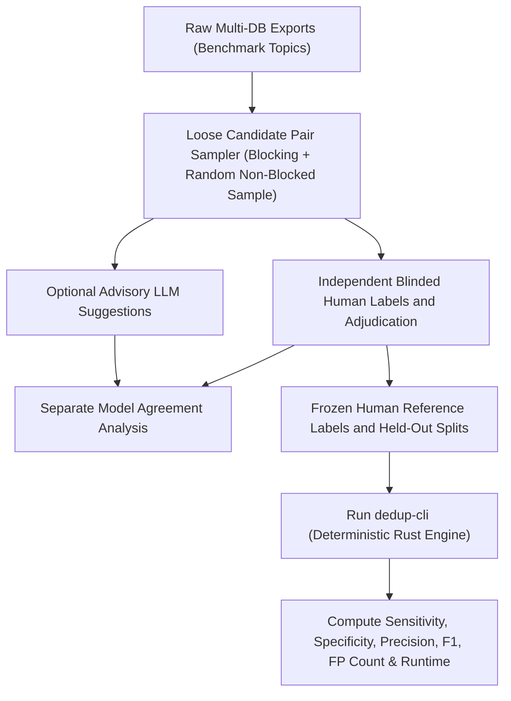

# 05 — External Validation Strategy & Tier 3 LLM Oracle Rubric

> **Correction, 2026-11-01:** "Oracle" is a historical label for an optional
> advisory model, not ground truth. The [engine contract](10-engine-contract.md)
> governs independent human labels, held-out splits, uncertainty and data rights.
> Nothing in this document represents completed evaluation or implemented code.

> **CRITICAL ARCHITECTURAL BOUNDARY (Decision D-005):**
> The LLM validation step is **strictly an external testing and benchmarking harness (`validation/`)** used by us to evaluate and validate the accuracy of `record-deduplicator`.
> **It is NOT part of the `record-deduplicator` application or `dedup-core` / `dedup-cli` crates.**

---

## 1. Purpose of the External Validation Harness (`validation/`)

Accuracy claims require independent human-adjudicated reference datasets. LLM
suggestions can assist authorized labeling work, but unreviewed predictions are
not gold labels. Temperature zero does not guarantee reproducibility. The planned
evaluation separates model agreement from engine accuracy:

1. **Stage A (Reference Labels):** Independent reviewers label report identity using bibliographic evidence while blinded to engine predictions. Adjudicate disagreements and permit unresolved labels. Split by review/report family before tuning. If an authorized advisory LLM is evaluated, report its agreement with human labels separately, including abstentions and class prevalence.
2. **Stage B (Benchmark Evaluation):** `dedup-cli` runs on the full benchmark datasets, and `validation/` computes pairwise and cluster-level metrics against the verified gold standard and against comparator tools (ASySD, EndNote Bramer method, Zotero, Rayyan, Covidence, SRA-DM).

---

## 2. Tier 3 Validation Matrix & LLM Oracle Rubric

The historical rubric below supplies candidate labeling questions, not automatic
ground truth. Reviewers must distinguish same report from same study, inspect
conflicts and abstain when evidence is insufficient. Production thresholds must
not be used to define reference truth. Store model/prompt/version/response
provenance for any optional model suggestions.

| Procedural Dimension | Algorithmic Implementation in `dedup-core` (Shipped Rust Engine) | External LLM Oracle Validation Rule (`validation/` Benchmark Labeler Only) |
|---|---|---|
| **1. Capitalization & Bracketed Artifacts** | Fold to lowercase; unwrap whole-title `[...]` translated titles; strip only whitelisted tags (`[Abstract]`, `(Abstract)`, `[Book Review]`, etc.); strip HTML tags & punctuation. | **Ignore Formatting:** Treat `TITLE [ABSTRACT]` and `Title.` as identical strings ($\text{Similarity} = 1.0$). If a title is a translated title in brackets matching the English/vernacular title of the same work, treat as identical. |
| **2. DOI / Unique Identifier Match** | Preserve full normalized DOI, namespaced accession IDs, guards and conflicting identifiers. Trial IDs are relationship evidence only. | Check actual report identity, including copied/erroneous IDs and version/type conflicts. No identifier or model suggestion overrides contradictory bibliographic evidence. |
| **3. Author First/Last Name Reversal & Hyphenation** | Tokenize author lists (`;`, `and`). Generate canonical `(family, given)` plus reversed permutation (`Smith, John` <-> `John Smith`) and hyphenated initial prefixes (`Kang, S. W.` <-> `Sungwoo Kang`). | **Permutation Verification:** Verify whether Author Set A is an exact, initial-truncated, hyphen-collapsed, or first/last-transposed permutation of Author Set B (e.g., `Kang, S. W.` == `Sung-Woo Kang` == `Sungwoo Kang`). |
| **4. Title + Abstract Fuzzy Equivalence** | Compute normalized Levenshtein ratio + token Jaccard on Title, and token cosine + containment similarity on Abstract (stripping APA/publisher copyright trailers first). | **Semantic Equivalence Check:** Compare study sample size ($N$), population, intervention, study design, and quantitative findings in the abstract. If reporting the exact same study and publication -> merge (`BIBLIOGRAPHIC_DUPLICATE`). If reporting a follow-up cohort, updated $N$, or Sub-study 2 -> label `DISTINCT` or `KIN_REPORT`. |
| **5. Issue / Volume / Online First Lifecycle** | Missing or provisional pagination does not veto a supported match; contradictory final pagination remains evidence for review. | Establish whether records represent the same report. Year/pagination changes can fit Online First, but title similarity alone is not proof. |
| **6. Conference Abstract / Preprint / Dissertation vs. Journal Article** | Inspect Publication Type (`PT`/`TY`/`M3`), supplement pagination (`S12`, `1p`), ERIC `ED` vs `EJ`, ProQuest Dissertation, or preprint server (`arXiv`, `bioRxiv`, `EdArXiv`, `SSRN`, `NBER`). | **Bibliographic vs. Data Duplicate (`KIN_REPORT`):** If Title/Abstract/Authors match the same study, but Record A is a Conference Proceeding/Supplement Abstract, Preprint, Working Paper, or Dissertation and Record B is a Peer-Reviewed Journal Article, classify as **`KIN_REPORT` (Data Duplicate / Related Study Report)** — retain Journal Article as primary and link Record A for PRISMA reporting. |

---

## 3. Gold Sets, Sampling & Target Metrics

### 3.1 Benchmark Gold Datasets
1. **Public Biomedical Benchmarks (ASySD):**
   - The 5 benchmark systematic review datasets from Hair et al. (2023) (`https://github.com/camaradesuk/ASySD`), providing direct comparability with published sensitivity/specificity figures in biomedical literature.
2. **Multi-Disciplinary Contemporary Benchmarks (Our Public Study):**
   - Real multi-database exports collected using the protocol in [`06-benchmark-search-protocol.md`](06-benchmark-search-protocol.md) across:
     - **Special Education** (Reading interventions in LD/dyslexia)
     - **General Education** (Generative AI / ChatGPT in education)
     - **Psychology** (Social media & adolescent mental health)
     - **Medicine** (GLP-1 receptor agonists for obesity)
     - **Nursing / Allied Health** (Nurse burnout & intention to leave)
3. **Synthetic Perturbation Suite (`testdata/fixtures/synthetic/`):**
   - Deterministic perturbation generator that takes clean seed records and injects controlled rates of:
     - APA/Elsevier copyright trailers, `[Translated Title]` brackets, `[Abstract]` tags, HTML `<i>`/`` tags;
     - East Asian hyphenated vs. unhyphenated names and first/last reversals;
     - Online First $\pm 1\text{–}2$ year shifts and missing pagination;
     - Truncated abstracts;
     - Hard negative traps (Part I vs. Part II, Erratum notices, Book Reviews, Replies, same generic title `Editorial` across issues).

### 3.2 Pair Sampling Strategy and Its Limits
- Evaluating only pairs that `dedup-core` blocked would miss false negatives dropped by the blocking stage.
- Therefore, `validation/` samples:
  1. Independently generated candidate/reference sets, with documented sampling
     rather than an unbounded requirement to label every loose-blocker pair.
  2. Stratified nonblocked samples with known inclusion probabilities, weighted
     estimators, uncertainty and independent reference clusters. This does not
     by itself prove unbiased recall or a particular completeness threshold.

Keep seed perturbations and related report families together in one split.
Measure candidate completeness separately from classifier recall. Publish
automatic and review-assisted outcomes separately; report actual report errors,
not study losses unless study labels exist. Pairwise specificity alone can be
misleading because almost all possible pairs are negative.

### 3.3 Target Performance Thresholds

All numbers below are exploratory targets, not measured results or guarantees.
Release gates and interpretation are in [the plan](08-development-plan.md).
Report confidence intervals, strata, hardware, release build, warm/cold runs and
peak memory. Review burden includes unique records/clusters and human minutes.
- **Auto-Merge Precision (`EXACT_DUPLICATE` + `BIBLIOGRAPHIC_DUPLICATE`):** $\ge 0.995$ (Specificity $> 0.999$ — near-zero false positives that would delete a unique study).
- **Overall Recall / Sensitivity (Auto-Merge + Review Queue):** $\ge 0.96\text{–}0.99$.
- **Human Review Queue Size (`PROBABLE_DUPLICATE`):** $< 2\%$ of total input records (minimizing manual burden).
- **Throughput:** 50,000 records deduplicated in $< 2$ seconds on a standard laptop CPU.
