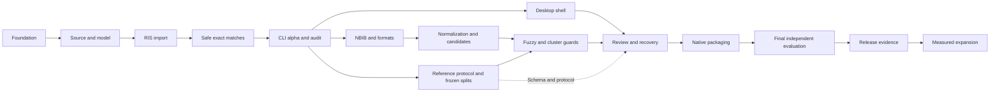

# Full development plan

Owner: SKang393. Revised: 2026-11-02.
This is the execution order; [TASKS.md](../TASKS.md) retains the original M0-M9
task inventory. [Engine contract](10-engine-contract.md) resolves older design
conflicts.

## Starting state and delivery boundaries

The starting snapshot on 2026-11-02 covered preparation only, with collection
stopped at the user's direction. The [development tracker](../TASKS.md) records
later scope decisions. The [collection protocol](06-benchmark-search-protocol.md)
is retained for separately authorized collection runs.
The ten core validation fields are medicine, neuroscience, public health,
psychology, pharmacy/pharmacology, engineering, health science, environmental
science, education/educational research and computer science. Special education
is supplemental. The prior five-field topic proposal is superseded.

Use existing observations to specify parser fixtures, source manifests and
evaluation design. Do not acquire more samples as a prerequisite for B01.
Missing samples do not prevent synthetic implementation, but incomplete format
evidence must remain visible in the handoff. No validation experiment starts
automatically during development. The
requested later five-model conditions are in [the validation handoff](13-future-validation-conditions.md).

The foundation has two Rust workspace members, a truthful help/version CLI,
documentation checks, and Windows/macOS CI. No parser, matcher, benchmark, or GUI
is implemented. See [preparation evidence](11-preparation-review.md) for actual
checks. Current scaffolding introduces no third-party runtime dependency.

| Delivery | Batches | User-visible result | Acceptance gate |
|---|---|---|---|
| CLI alpha | B01-B04 | RIS import, conservative exact-identifier matching, retained conflicts, reversible audit, RIS/JSON output. | Real end-to-end fixture run, source hashes unchanged, count reconciliation and no unsafe merges in adversarial suite. No fuzzy-accuracy claim. |
| Evaluation-ready CLI | B05-B07, B08a | NBIB and broader formats, bounded fuzzy candidates, guarded clusters, frozen evaluation protocol. | Deterministic artifacts on Windows/macOS, documented format coverage and frozen family-disjoint splits. Accuracy remains unmeasured until B08b. |
| Desktop candidate | B09-B11 | Add files, inspect/resolve, undo/resume, export through the same engine. | Native workflows, recovery/accessibility checks and candidate installers on both platforms. |
| Validated beta / V1 release | B08b, B12 | Completed program, measured evidence and documented operating limits. | Independent evaluation after the production candidate is complete; release gates below. |
| Later expansion | B13 | New discipline profiles and search-update workflow. | Measured incremental value without relaxing safety or contaminating held-out evaluation. |

No calendar estimate is asserted before B04 produces an actual vertical slice.
Work in bounded batches, splitting a batch if it cannot be
implemented and verified together. Do not start all milestones at once.
The sequential route is B01-B06, B08a, B07, B09-B11, B08b, B12, then B13.
B08a may start earlier after B04; the split freeze must precede corpus tuning.



Human-label protocol design can proceed alongside B01-B07. Actual collection
requires a separate user-selected run and is currently stopped.
Missing proprietary data blocks vendor support and accuracy claims, not synthetic
implementation. Exact manuscript attributions remain gated by verification via
Aside; they do not block code that is clearly identified as our design choice.

## Batch contracts

Paths listed below are **planned ownership paths**, not claims those modules
already exist. Create only what the selected batch needs. Each batch adds named
regression tests to the existing Cargo suite or an explicitly introduced tool.

### B01: Source, canonical record and policy contracts

- Depends on: foundation. Maps to M1.1 and the early part of M5.1.
- Own: `crates/dedup-core/src/model.rs`, `source.rs`, `policy.rs`, corresponding
  tests, and synthetic fixture metadata. Lead integrates `lib.rs`, manifests and
  lockfile. Choose `serde`/`serde_json` and SHA-256 crate only after checking current
  stable APIs, compatible licenses, and edition/MSRV requirements.
- Implement immutable source snapshots, content/record identity, ordered raw
  fields, multi-valued namespaced IDs, raw versus comparison values, diagnostics,
  five classes, typed relation edges and field origins. Version schemas.
- Acceptance: identical bytes and logical source manifest produce stable IDs;
  reimport of that source is diagnosed; independently declared database exports
  with identical bytes retain separate occurrence IDs and source counts;
  identical records at different ordinals remain separate; same AN
  in two database namespaces does not compare equal; raw unknown tags survive.
- Validate: `cargo test --workspace --locked` plus format/lint gate. Save actual
  cases and result paths in TASKS before marking complete.

### B02: Loss-aware decoding and RIS import

- Depends on B01. Maps to M1.2-M1.3.
- Own: `encoding.rs`, `parsers/mod.rs`, `parsers/ris.rs`, parser tests, small
  synthetic RIS fixtures with provenance and expected records.
- Implement BOM-aware UTF-8/UTF-16, explicit warned legacy fallback, CRLF/LF/CR,
  continuation lines, repeated/unknown tags, malformed/truncated records,
  maximum record/field sizes, progress and cancellation hooks. Database origin
  can be unknown or supplied; do not infer database from a filename as fact.
- Acceptance: decode fixtures on both OSes; original bytes recoverable; ordered
  repeated tags retained; malformed inputs return useful diagnostics without
  panics or silent record loss. A parser cannot silently return zero records for
  a recognized broken file. Real dialect support waits for real sample evidence.
  The first observed EBSCO exports contain repeated `ID`/`N1` and sparse `AB`/`DO`
  fields; use the [dated tag inventory](03-database-schemas-and-formats.md) to
  define synthetic cases. Original occurrence identity must not depend on one
  vendor `ID` value or on the presence of an abstract.
  Received WoS Full Record RIS files retain a UTF-8 BOM; some records lack
  abstracts, and the inspected first MED batch contains neither `AN` nor `UT`.
  Accept declared source provenance without requiring an accession tag, count
  the first BOM-prefixed record correctly, and preserve the original bytes.
- Validate: Cargo suite with parser golden cases and source-hash assertions.

### B03: Conservative exact-identity pipeline

- Depends on B02. Maps to selected M2, M3.2, M4.2-M4.3.
- Own: identifier/text comparison modules, `guards.rs`, `classify.rs`,
  `cluster.rs`, and versioned conservative policy. No fuzzy auto-merge yet.
- Match full DOI/PMID/ERIC identifiers with compatible type and sufficient
  bibliographic sanity. All identifier conflicts and sparse cases remain for
  review. Trial IDs produce relationships only. Check every proposed union for
  cannot-link conflicts and preserve unresolved members.
- Acceptance fixtures: DOI URL versus literal; `.v1` versus `.v2`; original versus
  erratum/retraction notice; Part I versus Part II despite copied DOI; protocol
  versus results sharing NCT; cross-database AN collision; A-B/B-C bridge with
  A-C conflict; missing-title same DOI; retracted original duplicated across DBs.
- Validate: Cargo suite. No false automatic merge in these named hard negatives.

### B04: First useful CLI, merge, export and replay

- Depends on B03. Maps to M5.1-M5.3, initially RIS and JSON only.
- Own: `merge.rs`, `export/`, `audit.rs`, `project.rs`, CLI command modules and
  integration tests. Introduce a CLI parser dependency only with fit rationale.
- Implement `dedup run`, `inspect`, `stats`, `verify-determinism` and a documented
  decision-application/replay interface. Final flags and JSON schema must be
  committed with this batch; they are not available in today's help-only CLI.
- Read multiple sources into a versioned local project; emit retained and
  suppressed records, unresolved queue, relations, field provenance, canonical
  manifest and diagnostics. Handle output collisions, interrupted writes and
  source/output path overlap. No source mutation. Keep relative source identities
  out of machine-specific result bytes.
- Acceptance: two RIS files through real CLI produce correct records and k-1
  suppression counts; conflicts/kin/unresolved remain; decisions replay after
  reload; undo restores prior state; failures return nonzero exit codes; repeated
  runs yield identical canonical bytes; original source hashes unchanged.
- Validate: Cargo integration suite and one actual fixture import-to-export run.
  Record command, version/policy hashes, counts and artifacts. This is the first
  CLI alpha gate, not evidence of broad real-world accuracy.

### B05: Format coverage in three small sub-batches

- Depends on B04. Maps to M1.4 and missing WoS/TSV work in M1.
- B05a owns NBIB parser/export plus full/abbreviated author pairing, PMIDs,
  date variants, language/title alternatives and publication-status fields.
- B05b owns CSV/TSV mapping UI-independent schema and WoS tagged `.ciw` import.
  Resolve ambiguous headers visibly. Protect spreadsheet exports from formula
  execution. Test delimiters, quoting, line breaks, Unicode and empty columns.
- B05c owns EndNote XML and BibTeX import/export, entities, nesting/size limits,
  multiline/braced values and nonstandard fields. No external XML entities.
- Every sub-batch adds format-specific fixtures and reimport tests, with explicit
  loss reports for unrepresentable values. Unknown raw fields remain in JSON.
  Publish a tested format/dialect table, not a universal vendor-support claim.
- Validate: Cargo parser/export integration suite for that sub-batch. Do not
  release a listed format whose representative smoke import has not succeeded.

### B06: Normalization and bounded candidate generation

- Depends on B05a; B05b/c may proceed independently after interfaces settle.
  Maps to M2.1-M2.5 and M3.1.
- Own: `normalize/`, `blocking.rs`, normalization/candidate fixtures.
- Implement Unicode-preserving keys, marker-aware title cleanup, scoped abstract
  trailers, author ambiguity, Online First metadata, journal fallbacks and
  versioned optional lookup data with proven redistribution rights.
- Use full-identifier, title, author/year, rare-token and journal/page candidates
  with measured block sizes. Relation-only candidates stay separate. Specify
  exact year boundary behavior, missing fields, stable pair ordering, resource
  limits, progress and cancellation. Never silently drop excess candidates.
- Acceptance: non-Latin titles remain nonempty; initials do not override
  conflicting full names; `15p.` is page count; translated titles are preserved;
  unknown-year/generic-title/common-author stress data returns bounded or explicit
  incomplete results; known positives measure candidate recall independently.
- Validate: Cargo suite and a recorded release-build candidate stress run with
  input size, candidate count, peak memory and elapsed time. No 2-second promise.

### B07: Fuzzy scoring and constrained clusters

- Depends on B06 and the B08a split freeze before any corpus-based tuning. Maps
  to M4 and remaining M5 behavior. Synthetic safety cases can be implemented
  before labels are available; held-out records cannot be used to tune thresholds.
- Own: `scoring.rs`, policy thresholds, guard/classifier/cluster extensions and
  adversarial fixtures. Do not alter parsers in this batch unless a tested defect
  blocks these cases.
- Implement per-field scores, missing-evidence handling, abstract containment,
  author alignments, conflict-aware Online First matching and explained review
  routing. Thresholds are tuned only on development data. Formalize score
  rounding, stable reductions and deterministic master selection.
- Acceptance: all B03 negatives remain protected; missing abstracts are not
  perfect matches; copied titles with disjoint authors retain records; generic
  titles, supplements, versions and multipart studies do not bridge clusters.
  Thread counts and OSes produce identical canonical fixture outputs.
- Validate: Cargo suite plus serial/parallel and Windows/macOS golden artifact
  comparisons. A matching failure blocks accuracy claims, not just a test badge.

### B08a: Reference protocol, split freeze and harness preparation

- Depends on B04 for runner contracts; complete the split gate before corpus-based
  B07 tuning. Maps to preparation for M6.1. This is protocol/reference work, not
  the final program or LLM experiment.
- Own only `validation/`, human-label templates, permitted dataset manifests and
  reviewed evidence reports. No production dependency on Python or model APIs.
- Create independent reference labels, review/family-level splits, blinded dual
  labeling and adjudication, disagreement/abstention records, sampling strata and
  inclusion probabilities. Pin comparator versions/settings and dataset hashes.
  Preserve pre-dedup database counts, requested/delivered RIS counts and platform
  suppression evidence. Keep SPED out of primary core-field aggregates, and
  resolve overlapping reports across fields before creating held-out splits.
- Define measurements for automatic precision and recall, candidate completeness, cluster errors,
  incorrect report merges, retained kin reports, review-assisted outcomes, unique
  records/cluster queue size, reviewer minutes, parse losses, runtime and memory.
  Include uncertainty and sample sizes; report unevaluated strata.
- Acceptance: validate metric calculations against a tiny hand-calculated
  confusion matrix including a blocking miss and an erroneous cluster bridge.
  Freeze a versioned, hashed development/test manifest by report family, resolving
  cross-field overlap before B07 tuning. Access to test labels stays separate from
  threshold selection. A future report must be reproducible from saved outputs
  and reference labels without an LLM call.
- Validate: harness arithmetic self-check against the tiny hand-calculated fixture.
  This is a harness test, not final corpus validation. Commands are introduced in
  this batch and do not exist yet.

### B08b: Final independent evaluation after the program is complete

- Depends on B07, B08a and B11 production-candidate completion, including native
  Windows/macOS workflows. Execute this batch after B11, despite its grouping
  with evaluation preparation. Freeze the candidate revision and policy first.
- Run the independent held-out evaluation, comparator conditions and uncertainty
  analysis defined in B08a. Report every prespecified field and missing stratum.
  Do not tune on final results. Any subsequent change requires a new revision and
  an explicitly documented evaluation decision.
- Run the user's external LLM conditions only in this later phase after actual
  availability/settings verification. Keep model agreement separate from engine
  accuracy against human reference labels; no LLM enters the shipped program.
- Acceptance: dated outputs, input/output hashes, reproducible analysis, actual
  failure/retry records and independently checked counts. B12 and public accuracy
  claims require this evidence. Native implementation checks alone do not suffice.

### B09: Native desktop shell and import

- Depends on B04 stable contracts. Maps to first part of M7.
- Own `app/` frontend and Tauri host. Lead owns shared Cargo configuration.
- Initialize current Tauri 2/React/TypeScript/Vite/Tailwind/shadcn/TanStack Virtual
  with lockfile and explicit dependency licenses. Check official prerequisites
  for MSVC/WebView2 on Windows and Xcode tools/WKWebView on macOS.
- Bridge directly to core using versioned commands/events. Run work off the UI
  thread; show progress, cancellation, parse warnings and source confirmation.
  Restrict Tauri capabilities and filesystem scope; render imported markup as
  text. No network capability or telemetry is needed for core workflows.
- Acceptance: native Windows and macOS app imports the B04 fixture with the same
  IDs/counts; cancel leaves a recoverable project; unsupported files fail clearly;
  keyboard focus, scaling and light/dark views are checked with evidence.
- Validate: frontend type/build checks and native smoke artifacts. Browser-only
  screenshots do not establish native webview or packaged-app acceptance.

### B10: Review, recovery and reporting UI

- Implementation depends on B07/B09 and B08a schema/protocol contracts, not
  final evaluation results. Completed B08b gates validated-beta acceptance and
  public release; B10 workflow completion can proceed to B11 candidate packaging.
  Maps to remaining M7.
- Own review/export UI, project persistence integration, accessibility tests.
- Implement side-by-side field differences, conflict/guard explanations,
  merge/keep/link/skip, undo/redo, session resume, source/field provenance, virtual
  tables, keyboard shortcuts and draft PRISMA counts/methods. Bind decisions to
  input/policy versions so stale decisions cannot silently apply to changed data.
- Acceptance: save, close, reopen, replay, undo and export preserve the same
  results; crash/interrupted-write recovery does not lose sources; unresolved
  pairs remain in screening output; counts reconcile; Ctrl/Cmd shortcuts do not
  fire inside text inputs; 50k-row interaction is measured, not assumed.
- Validate: meaningful frontend tests plus a native import-review-undo-resume-
  export scenario on both platforms, with artifact hashes and screenshots.

### B11: Packaging, installation and supply-chain checks

- Depends on B10. Maps to M8.
- Own release workflow, bundle config, installation docs and release manifest.
- Build Windows installer and macOS arm64/x86_64 or verified Universal bundles.
  Verify actual CPU slices. Pin release tools/dependencies, inspect licenses,
  package contents and SBOM, exclude `validation/`, private data and credentials.
  Produce checksums, source revision and policy/schema versions.
- Code-sign/notarize when credentials exist; otherwise label unsigned review
  builds and mark public distribution gate blocked. Never fabricate signing or
  install evidence. Release credentials do not enter the repo or forks' CI.
- Acceptance: install, offline import/review/export, upgrade preserving projects,
  and uninstall without destroying user data on clean Windows and macOS systems.
- Validate: both native builds plus recorded install workflows and file hashes.
  CI compilation alone does not satisfy installation or human workflow checks.

### B12: Release evidence and optional LLM assistance

- Depends on B08b and B11. Maps to M6.2 and publication/release closeout.
- Re-run a frozen evaluation only for changed engine/policy or unresolved defects.
  Publish versioned metrics, methods, limits, comparator conditions and admitted
  public fixtures. Audit every README claim against evidence.
- Optional external LLM label suggestions live only in `validation/`, are opt-in
  for authorized data, use structured output, allow abstention, and preserve
  provider/model/prompt/response/cost provenance. Temperature zero is not a
  reproducibility guarantee. Human-adjudicated truth remains authoritative.
- Acceptance: claims trace to evidence; no unreviewed proprietary data or raw
  manuscript text is published; production artifacts and dependencies contain no
  oracle/API keys; all release gates below are satisfied or release stays blocked.

### B13: Post-v1 expansion

- Depends on measured need after v1. Maps to M9.
- Add discipline profiles only with separate held-out improvement and no safety
  regression. Add explicit search-update/import-history workflows with stable
  prior decisions and well-defined counting. Consider additional formats and
  provider relations individually. Cloud services, semantic production matching,
  study-level synthesis and report suppression require new decisions and scope.

## Release gates and external blockers

| Gate | Required evidence | Current state |
|---|---|---|
| Source preservation | Original-byte recovery, hashes unchanged, undo and replay | Not implemented |
| Report safety | Every hard-negative fixture passes; zero known unsafe auto-merges in held-out safety cases | Not implemented |
| Matching quality | Proposed auto-merge precision >=0.995 and candidate completeness >=0.995, with denominators, intervals and per-stratum results | Targets, unmeasured; report uncertainty and do not release on inadequate evidence |
| Recall and workload | Automatic and review-assisted recall separately; target combined recall >=0.96; measured review minutes and queue size | Targets, unmeasured; old <2% queue goal is exploratory |
| Determinism | Same canonical hashes across repeated runs, thread counts and Windows/macOS | Not implemented |
| Native delivery | Actual offline workflows, recovery and installer checks on both OSes | Not implemented |
| Data rights | Admitted fixtures, permitted comparator inputs, reviewed public artifacts | Proprietary samples and human reference labels not supplied |
| Distribution | Correct identity, licenses, checksums, signing/notarization evidence | Repository license prepared; release credentials not assessed |

Threshold point estimates alone are insufficient; if confidence intervals or
rare high-impact subgroups are inconclusive, expand evaluation or narrow the
release claim. Never claim study-loss rates from report-only labels.

## Integration and validation discipline

For a broad batch, use one lead integrator and up to three available subagents:
data/parsers, matching/safety, and validation/UI as relevant. Assign nonoverlapping
files; shared models, manifests, lockfiles, TASKS and commits belong to the lead.
Use waves instead of concurrent edits to shared files. If delegation is
unavailable, continue single-agent and state that limitation.

Existing checks, runnable from the repository root:

```text
python scripts/check_docs.py
cargo fmt --all --check
cargo clippy --workspace --all-targets --locked -- -D warnings
cargo test --workspace --locked
```

Run the appropriate suite after an integrated batch, not after every line.
Future batch-specific commands must be created, run and recorded before a task
is checked off. On failure, record exact command, error, likely cause and files.
Stop only the dependent work; continue independent authorized tasks. Do not
publish a release or claim a feature merely because a scaffold builds.

Architecture references: [Cargo workspaces](https://doc.rust-lang.org/cargo/reference/workspaces.html),
[Tauri prerequisites](https://v2.tauri.app/start/prerequisites/). Resolve actual
dependency versions and APIs at implementation time and commit their lockfiles.
